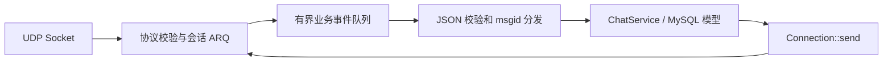

# RChat — Reliable UDP Chat / C++17

本地自封装 UDP 聊天服务器。原虚拟机项目不参与构建或修改。JSON 业务体、用户/好友/群组模型和 `msgid` 分发沿用原项目，活动网络层已移除 muduo/TCP 依赖。

先读 [改造设计与解耦计划](docs/UDP_DESIGN.md)，再读 [完整协议规范](docs/UDP_PROTOCOL.md)。



## 目录与职责

| 目录/文件 | 职责 |
| --- | --- |
| `include/net`、`src/net` | 二进制编解码、CRC32、握手、分片、停等 ACK/重传、心跳、会话、WinSock/POSIX socket、有界队列 |
| `include/net/connection.hpp` | 业务与传输之间的连接接口、请求上下文、完成回调 |
| `src/server/chatserver.cpp` | 独立网络线程、业务事件消费、JSON 校验和会话身份检查 |
| `src/server/chatservice.cpp` | 复用的聊天业务；离线批次确认、发送失败补偿 |
| `src/client/main.cpp` | C++ UDP JSON 命令行客户端 |
| `src/tools/udp_echo_server.cpp` | 不依赖数据库的 UDP 演示服务 |
| `test/udp` | 协议/丢包模拟/真实 socket/业务适配测试 |
| `db` | 本地开发库 schema 和旧离线表的主键迁移脚本 |

## 本地 Windows 构建

需要 Visual Studio C++ 工具、CMake 和 MySQL Connector/C 开发库（本机已验证 MSVC 19.51 + MySQL 8.0）。无需 VMware 或 muduo。

在项目目录的 PowerShell 运行：

```powershell
./scripts/build.ps1
```

脚本通过 vswhere 找到 MSVC，并仅在当前进程设置编译环境，构建及执行 CTest。MySQL 默认查找 `C:/Program Files/MySQL/MySQL Server 8.0`；其他位置可先用 CMake 指定 `MYSQL_INCLUDE_DIR` 和 `MYSQL_LIBRARY`。Windows 优先使用 `libmysql.lib` 动态导入库，生成服务端时复制 `libmysql.dll` 及相邻安装目录的 OpenSSL DLL 到同目录。

只使用独立 UDP 库、客户端和演示服务，无需 MySQL 开发库：

```powershell
./scripts/build.ps1 -TransportOnly
```

VS Code 的默认构建任务也指向本地项目，Windows 下调用上述脚本。

## Linux 构建

需要 C++17 编译器、CMake、线程库；完整业务服务还需要 MySQL/MariaDB 客户端开发包。

```sh
cmake -S . -B build -DCMAKE_BUILD_TYPE=Debug
cmake --build build -j
ctest --test-dir build --output-on-failure
# 独立网络工具：配置时加 -DCHAT_BUILD_SERVER=OFF
```

本轮实际编译及 socket 测试平台是 Windows；Linux 分支使用 POSIX API，尚未在 Linux 主机实测。

## 先运行无数据库的通信演示

打开两个终端（Linux 去掉 `.exe`）：

```powershell
./build/UdpEchoServer.exe 127.0.0.1 6000
./build/UdpClient.exe 127.0.0.1 6000 '{"msgid":5,"msg":"hello UDP"}'
```

客户端先握手，再发送二进制封装的 JSON，输出回显后退出。省略最后一个 JSON 参数可持续输入请求，接收线程同时打印服务端响应和主动消息，`/quit` 退出。单次模式仅用于一条请求/响应；聊天和多批次离线同步请使用持续模式。普通 telnet/TCP 客户端不兼容该协议。

## 接入复用的 MySQL 业务

1. 在**本地开发数据库**初始化 `db/schema.sql`。脚本创建 `chat_udp`，不自动执行。如复用旧数据库副本，先检查 `OfflineMessage`：确认旧表没有 `id` 后，才对副本执行 `db/migrate_offline_ids.sql`。
2. 设置以下环境变量；默认主机 `127.0.0.1`、端口 `3306`、用户 `root`、数据库 `chat_udp`，默认密码为空。
3. 运行完整服务端。数据库不可用时明确报错退出。

配置字段参见 [`.env.example`](.env.example)，其中用户名和密码均为示例，请替换为你本地数据库的实际值。程序读取进程环境变量，**不会自动加载 `.env` 文件**；可用下列命令设置。真实凭据只保存在本地环境或被 Git 忽略的 `.env` 中，不要写入源码或提交到仓库。

```powershell
$env:CHAT_DB_HOST = '127.0.0.1'
$env:CHAT_DB_PORT = '3306'
$env:CHAT_DB_NAME = 'chat_udp'
$env:CHAT_DB_USER = 'example_db_user'
$env:CHAT_DB_PASSWORD = 'example_db_password'
./build/src/server/ChatServer.exe 127.0.0.1 6000
./build/UdpClient.exe 127.0.0.1 6000
```

常用请求（每行一条，注册返回用户 ID 后用于登录；用户名和密码均为虚构示例）：

```json
{"msgid":3,"name":"alice","password":"example_chat_password"}
{"msgid":1,"id":1,"password":"example_chat_password"}
{"msgid":5,"to":2,"msg":"hello"}
{"msgid":6,"friendid":2}
{"msgid":10,"groupname":"udp","groupdesc":"UDP group"}
{"msgid":12,"groupid":1}
{"msgid":14,"groupid":1,"msg":"hello group"}
{"msgid":16}
{"msgid":8}
```

登录后服务端从会话补充发送者 `id`；主动提供其他用户的 `id` 会被拒绝。`reply_to` 是传输请求编号，JSON `msgid` 是业务类型，两者不同。登录响应提供 `offlinemsg` 和 `offline_more`，后续用 16 拉取。若上一批 ACK 尚未处理，拉取返回忙，稍后重试即可。

## 验证范围和边界

`udp_tests` 检查编解码、字节序、CRC、畸形报文、HELLO/WELCOME/DATA/ACK 丢失、重复和乱序、64KiB 分片重组、双向顺序、队列背压、资源上限、重传及心跳超时、真实 socket 和线程边界。

`chat_business_tests` 使用真实 ChatServer/ChatService 和真实 UDP，**仅把 MySQL I/O 替换为内存模型**，验证注册、登录、发送者校验、单聊、群聊、离线拉取、消息确认及失败保留。

此外，已在 build 下的独立临时 MySQL 数据目录完成真实 SQL 与 UDP 端到端验证，包含 UTF-8/引号、分片聊天和离线消息确认删除；测试进程和数据目录均已清理，没有访问已有业务数据库。完整记录及未验证范围见 [VALIDATION.md](docs/VALIDATION.md)。实际使用 MySQL 时仍需按上文初始化你选择的本地开发库。

v1 面向学习和可信局域网开发：停等窗口为 1，固定数据报上限 1200 字节，逻辑消息 64KiB；业务请求 8KiB。它提供会话内去重和有界失败处理，不提供持久化 exactly-once、加密、NAT 地址迁移或完整公网拥塞控制。单聊受理成功不等于对方已读。具体交付语义和限制见协议文档。

旧 `test/testmuduo` 是保留的历史 TCP 示例，不参与 UDP 构建。
